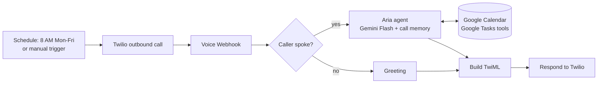
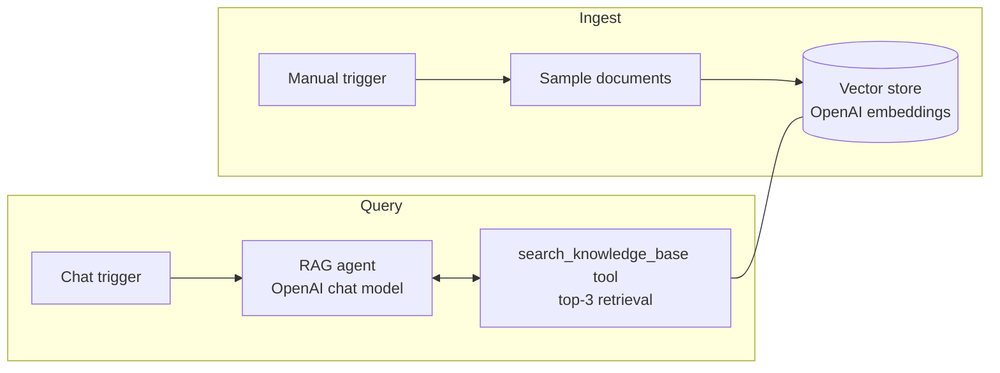

# AI Automation Portfolio: n8n + LLM Agents

**Production-minded AI automations built with n8n, LLM agents, RAG and voice.**
Import-ready workflows you can run in minutes, and a clear path from demo to your real stack.

> **Looking to automate a process with AI?** [Skip to "Work with me"](#-work-with-me)

---

## What I build

| Capability | What it means for your business |
|---|---|
| **AI agents with tools** | Agents that don't just chat. They read calendars, update task lists, call APIs and take action. |
| **RAG / knowledge-base assistants** | Support and internal bots that answer from *your* documents and say "I don't know" instead of guessing. |
| **Voice automation** | Real phone-call assistants (outbound and inbound) using speech-to-text, LLMs and text-to-speech. |
| **Workflow orchestration** | Scheduled and event-driven pipelines connecting your tools with n8n. |

---

## Featured automations

### 1. [Voice Day-Planner Agent](workflows/voice-day-planner-agent/): *Gemini + Twilio + Google Workspace*

An AI assistant ("Aria") that **phones you at 8 AM on weekdays**, reads your Google Calendar and Google Tasks, and plans your day by voice. You can add tasks, mark them done and schedule events just by talking.



**Highlights**
- Tool-calling agent: 5 tools (read and create calendar events, list, add and complete tasks)
- Per-call conversation memory keyed by the Twilio call ID
- Voice-first prompt design: short replies, one question at a time, no markdown read aloud
- Clean hang-up handling with an `[END]` control token
- Language and voice are two constants, so switching to another language is a one-line change

### 2. [Simple RAG Demo](workflows/simple-rag-demo/): *OpenAI + vector store*

A retrieval-augmented chatbot that answers customer questions (refunds, support hours, shipping) **only from a knowledge base**, and admits when it doesn't know.



**Highlights**
- Grounded answers: the agent must call the retrieval tool first and answers only from its results
- Ingest and query paths are separated, so the knowledge base can be refreshed without touching the chat flow
- Uses n8n's in-memory store for a zero-setup demo. For production, swap in Pinecone, Qdrant or Supabase pgvector (see the workflow README).

---

## Tech stack

`n8n` · `OpenAI` · `Google Gemini` · `Twilio Voice` · `Google Calendar API` · `Google Tasks API` · `RAG / vector search` · `Webhooks` · `JavaScript (Code nodes)` · `TwiML`

---

## Quick start

1. Install or sign up for [n8n](https://n8n.io) (Cloud or self-hosted).
2. In n8n: **Workflows → Import from File** and pick a `workflow.json` from the `workflows/` folder.
3. Open each node that shows a credential warning and connect your own credentials.
4. Replace the `YOUR_...` placeholders (listed in each workflow's README).
5. Run it.

> Each workflow folder has its own README with required credentials, setup steps and a customization guide.

---

## Security and hygiene

- All credentials, phone numbers, account SIDs, calendar IDs and instance URLs have been **replaced with placeholders**. No secrets are committed.
- Credentials are referenced by name only. You connect your own inside n8n.
- Before deploying anything like this for real, I use separate credentials per environment, validate inbound webhooks (for example Twilio signature checks) and limit what each agent tool is allowed to do.

---

## 🤝 Work with me

I help teams turn manual, repetitive or call-heavy processes into reliable AI-powered automations.

**Typical engagements**
- AI support assistant on top of your docs, FAQs or help center (RAG)
- Voice agents for reminders, scheduling, lead qualification or follow-up calls
- Calendar, CRM, email and task automation across your existing tools
- Auditing and hardening an existing n8n setup

**How to reach me**

| | |
|---|---|
| **Name** | Varshika Kureti |
| **Email** | `your-email@example.com` |
| **LinkedIn** | `https://linkedin.com/in/your-handle` |
| **Location / time zone** | India (IST, UTC+5:30), open to remote work worldwide |

*Tell me the process you want to automate and I'll reply with an approach and rough timeline.*

---

## Repository layout

```
.
├── README.md
├── LICENSE
├── .gitignore
└── workflows/
    ├── voice-day-planner-agent/
    │   ├── README.md
    │   └── workflow.json
    └── simple-rag-demo/
        ├── README.md
        └── workflow.json
```

## License

Released under the [MIT License](LICENSE). Use the workflows freely. If they help your team, a ⭐ or a message is appreciated.
