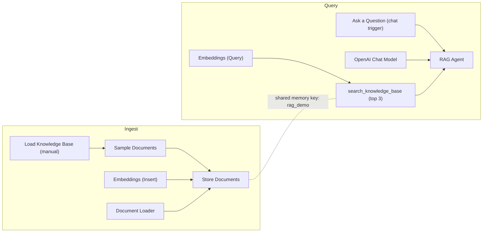

# Simple RAG Demo (OpenAI + Vector Store)

A retrieval-augmented generation (RAG) chatbot built in n8n. It answers questions about a fictional company ("Acme Corp") **strictly from a knowledge base** and says "I don't know" when the answer isn't there.

## What it does

1. **Ingest**: loads sample documents, splits them, embeds them with OpenAI embeddings and stores them in a vector store.
2. **Query**: a chat trigger sends the user's question to an AI agent. The agent must call the `search_knowledge_base` tool (top 3 matches) and answers only from what it retrieves.

The sample knowledge base covers refunds, support hours and shipping times, so you can see grounded answers right away.

## Architecture

## Requirements

- n8n (Cloud or self-hosted)
- An OpenAI API credential (used for both embeddings and the chat model)

## Setup

1. Import `workflow.json` into n8n.
2. Connect your **OpenAI** credential on the three OpenAI nodes.
3. Click **Load Knowledge Base** once to fill the vector store.
4. Open the chat and ask, for example, *"How long do refunds take?"* or *"Do you offer 24/7 support?"*.

## Try these questions

| Question | Expected behaviour |
|---|---|
| "What is your refund policy?" | Cites the 30-day money-back guarantee |
| "Are digital products refundable?" | Only if not downloaded |
| "How fast is express shipping?" | 1-2 business days |
| "Who is the CEO?" | Says it doesn't know, since it isn't in the knowledge base |

## Making it production-ready

- **Persistent vector store**: this demo uses n8n's in-memory store, so data is lost on restart and the memory key is shared across the instance. For real use, swap in Pinecone, Qdrant, Supabase pgvector or similar.
- **Real documents**: replace the *Sample Documents* node with Google Drive, Notion, PDF or website ingestion, and add a text splitter tuned to your content.
- **Refresh strategy**: run ingestion on a schedule or on document change instead of manually.
- **Channels**: replace the chat trigger with Slack, WhatsApp, a website widget or email.
- **Quality**: add source citations in answers, a feedback loop and a small evaluation set of questions.
