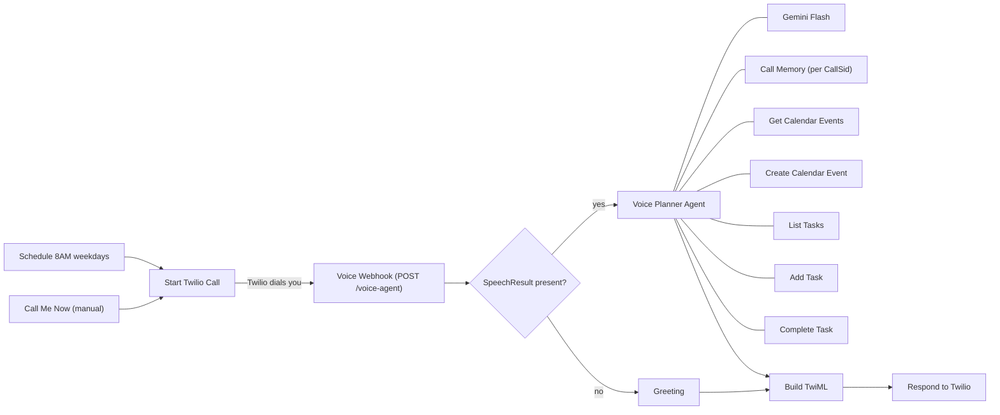

# Voice Day-Planner Agent (Gemini + Twilio)

An AI voice assistant named **Aria** that calls you, reads your Google Calendar and Google Tasks, and plans your day in a natural phone conversation.

## What it does

- **Calls you automatically** at 8 AM on weekdays (cron `0 8 * * 1-5`), or on demand via the **Call Me Now** manual trigger.
- **Understands speech** with Twilio `<Gather>` speech recognition and replies with neural text-to-speech.
- **Plans your day**: checks today's events and open tasks, suggests an order, adds focus blocks and breaks, and warns about clashes.
- **Manages tasks and events**: add tasks, list them, mark them complete and create calendar events, always confirming before changing anything.
- **Remembers the conversation** for the duration of each call.

## Architecture

## Requirements

| Service | Used for | Credential type in n8n |
|---|---|---|
| Twilio | Outbound call, speech recognition, TTS | Twilio API |
| Google Gemini | The agent's LLM | Google Gemini (PaLM) API |
| Google Calendar | Read and create events | Google Calendar OAuth2 |
| Google Tasks | List, add and complete tasks | Google Tasks OAuth2 |

n8n must be **reachable from the internet** so Twilio can call the webhook (n8n Cloud, or a tunnel such as ngrok for self-hosted).

## Setup

1. **Import** `workflow.json` into n8n (Workflows → Import from File).
2. **Connect credentials** on the Twilio, Gemini, Calendar and Tasks nodes.
3. **Replace placeholders**:

   | Where | Placeholder | Replace with |
   |---|---|---|
   | Start Twilio Call, URL | `YOUR_TWILIO_ACCOUNT_SID` | Your Twilio Account SID |
   | Start Twilio Call, `To` | `+YOUR_VERIFIED_PHONE_NUMBER` | The number to call (must be verified on a Twilio trial) |
   | Start Twilio Call, `From` | `+YOUR_TWILIO_VOICE_NUMBER` | Your Twilio voice-capable number |
   | Start Twilio Call, `Url` | `https://YOUR-N8N-INSTANCE/webhook/voice-agent` | Your n8n **production** webhook URL |
   | Both calendar nodes | `YOUR_CALENDAR_ID@gmail.com` | The calendar ID to use |

4. **Publish** the workflow so the production webhook is live.
5. Click **Call Me Now** and your phone rings.

## Customization

- **Timezone**: the agent prompt and tool hints use `Asia/Kolkata (+05:30)`. Change both for your region.
- **Language and voice**: edit the `VOICE` and `LANG` constants in the **Build TwiML** node (for example `te-IN` with `Google.te-IN-Standard-A`).
- **Schedule**: change the cron expression in **Morning Call 8AM Weekdays**.
- **Persona and behaviour**: edit the system message in **Voice Planner Agent**.
- **Different tools**: swap the Google nodes for Outlook, Notion, a CRM or Slack, keeping the `$fromAI(...)` parameters.

## Production notes

- Validate Twilio's `X-Twilio-Signature` on the webhook before trusting requests.
- The webhook currently needs no authentication, so add a signature check or a secret path before real use.
- Add an error branch and alerting for failed calls or tool errors.
